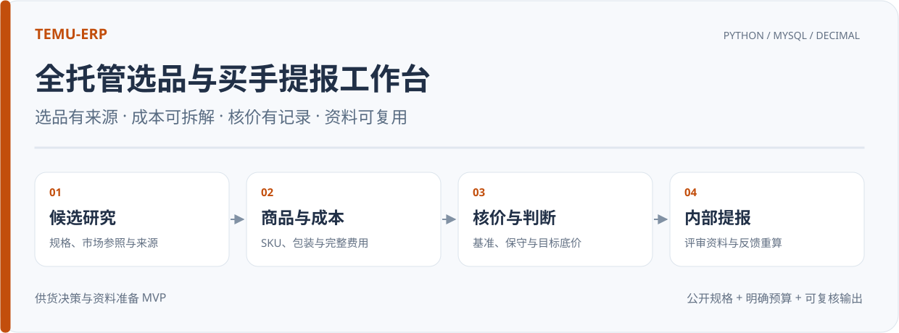
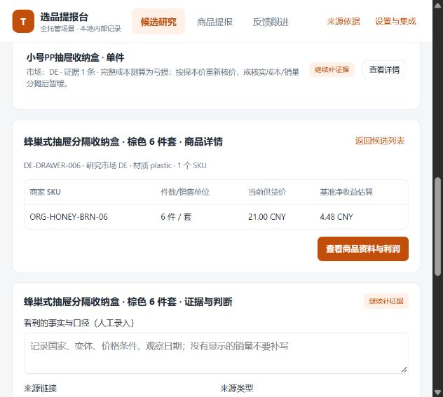
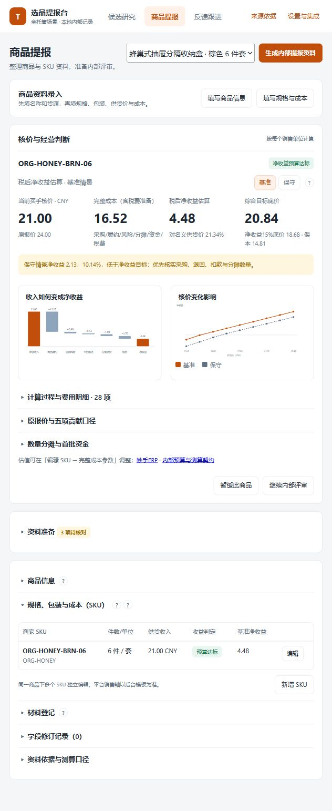
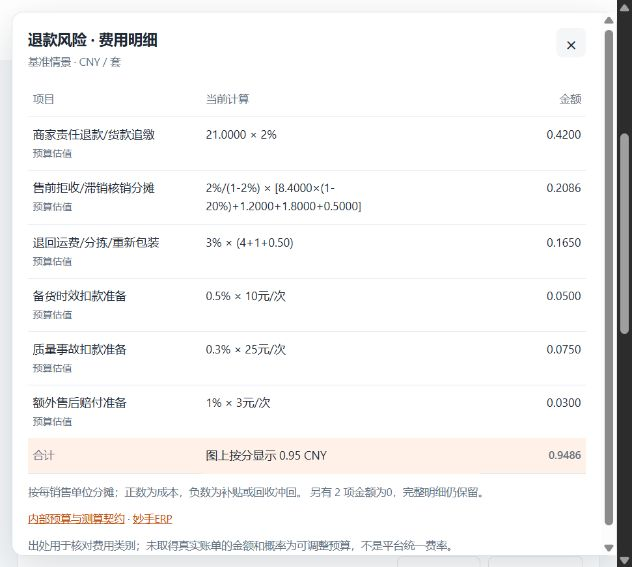
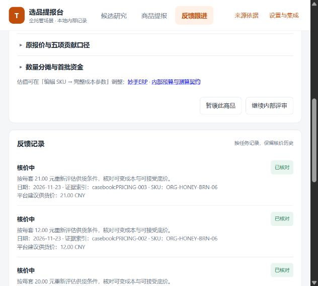
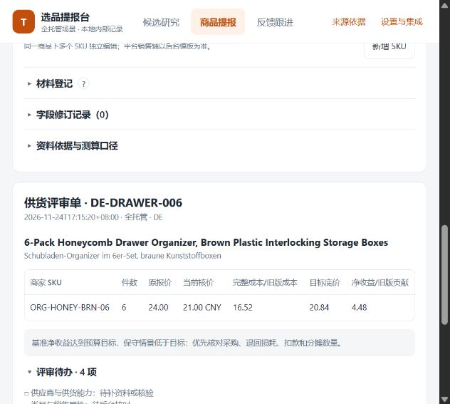
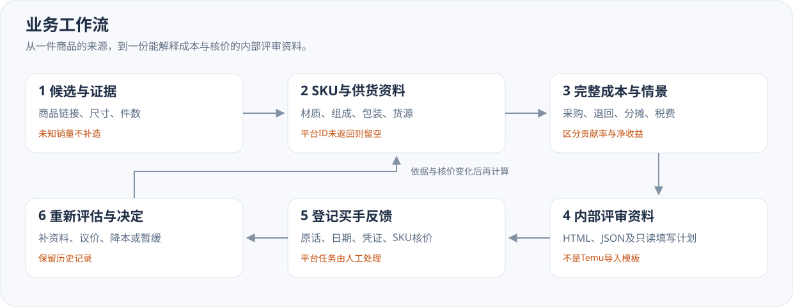
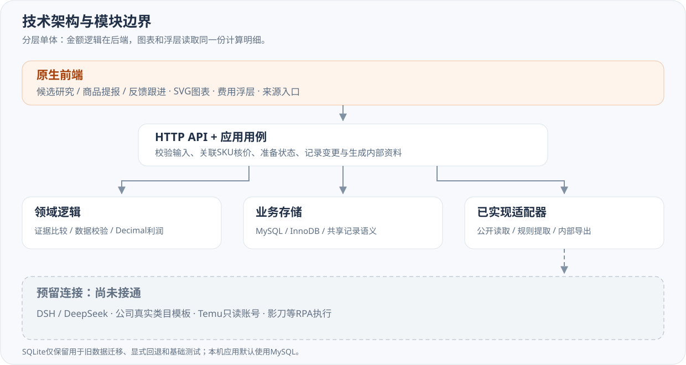
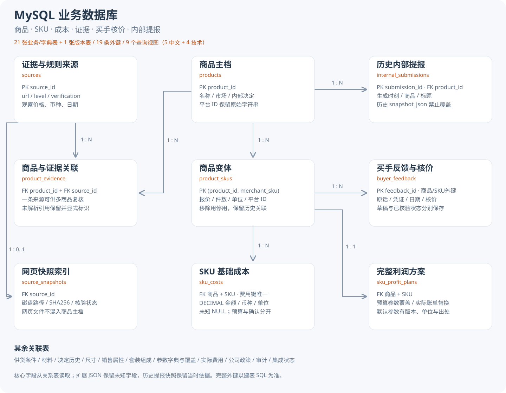

<p align="center">
  
</p>

# TEMU-ERP

**把“这个商品为什么值得供货”变成有来源、能算账、可复用资料的工作流。**

Python · MySQL 8 / InnoDB · Decimal · 原生 JavaScript · SVG 图表

[](https://github.com/666whatcanisay/TEMU-ERP/actions/workflows/ci.yml)

[界面预览](#界面预览) · [业务工作流](#业务工作流) · [技术架构](#技术架构) · [设计取舍](#设计取舍) · [快速运行](#快速运行) · [代码阅读路线](#代码阅读路线)

面向 **Temu 全托管供货场景**的选品与内部提报 MVP，以德国市场普通非电收纳用品为研究范围。使用者可以汇集市场证据、维护商品与 SKU、核算完整成本、登记买手核价，再生成内部评审资料。

项目从一个具体问题出发：**采购差价看起来够高，为什么供货后仍可能不赚钱？** 把退款、退回、扣款准备、人工、分摊、资金和税费纳入同一销售单位，才有条件讨论可接受的供货价。当前定位是单人本地工作台；实际类目模板、供货责任及平台任务仍需真实后台核验。

## 界面预览

下面均为实际运行界面，使用独立 MySQL 演示库和仓库内 5 个离线案例，不读取工作中的商家数据库。公开规格与预算假设分别登记；采购报价、概率、公司门槛和买手反馈是案例输入。[截图与数据说明](docs/assets/showcase/README.md)

### 1. 候选研究：先看供货空间与风险



比较基准与保守情景，亏损直接显示；商品详情关联规格、套装件数、观察日期和来源。图上是各销售单位的预算净收益，不能推断真实销量、市场排名或选品必然成功。

### 2. 商品提报：报价拆成完整成本与底价



新建后可填写商品、规格、包装和成本。关键结果是 **供货价 / 完整成本 / 净收益预算 / 目标底价**；瀑布图解释费用组成，敏感性曲线解释核价变化的影响。基准与保守使用同一套后端规则。

### 3. 费用明细：金额、公式和来源一起查看



悬停、键盘聚焦或点击图表项目，可查看费用组成、公式、金额和来源；点击可固定，Esc 或关闭按钮退出。ERP 文档支持费用类别，不把预算概率冒充成平台统一费率。导出 HTML 也保留费用交互。

### 4. 反馈跟进：核价关联 SKU，保留原报价



记录日期、原话、凭证和 SKU。最新有效核价只影响对应 SKU，原报价保留。缺少必要凭证时保存为草稿，不自动变成平台已确认事实。

### 5. 内部评审：同一份资料生成交付结果



HTML、JSON 和只读字段填写计划复用同一份资料，集中展示待核对项。**这是内部评审资料，不是 Temu 官方导入模板，不执行真实提报或上架。**

## 场景与功能

| 工作中的问题 | 当前能力 | 可检查的工程处理 |
|---|---|---|
| 不同尺寸、件数的竞品被直接比价 | 来源、规格、销售单位及可比性判断 | 未知销量保留 `null`，跨币种不直接相减 |
| 采购差价被当作最终利润 | 完整成本、基准/保守、目标底价 | Decimal、明细四位小数、旧五项贡献单独命名 |
| 一次核价影响全部变体 | SKU 级反馈与独立重算 | 关联商家 SKU、保留原价与反馈历史 |
| 商品资料分散、重复整理 | 多 SKU、材料登记、内部评审导出 | 资料、计算和导出共享业务数据 |
| 修改历史与商品保存不同步 | 商品和修订历史原子保存 | 同事务提交，失败一起回滚 |
| 商品和证据难直接查库 | 关系实体、来源网址列、9 个查询视图（5 中文 + 4 技术） | 19 条外键、定点金额、迁移摘要对账 |

## 业务工作流



1. **候选与证据**：记录市场参照，核对尺寸、材质、件数和价格背景。
2. **SKU 与供货资料**：维护变体、包装、重量、供应商与可供数量；平台 ID 未返回则留空。
3. **完整成本**：输入承担费用，比较两种情景，反推可接受底价。
4. **内部判断与评审**：补证据、议价、暂缓或准备内部资料，明确缺口。
5. **人工处理平台任务**：按真实后台与买手要求操作，再登记反馈。
6. **重新评估**：核价或成本变化后再算，决定继续、降本或放弃。

全托管场景下，工作台辅助准备与判断；最终核价、任务及售卖状态以平台实际结果为准。[详细工作流](docs/WORKFLOW.md)

## 一个能复核的算例

六件套案例 `DE-DRAWER-006` / `ORG-HONEY-BRN-06`，当前核价 **21 元/套**：

| 口径 | 结果 | 含义 |
|---|---:|---|
| 原五项可变成本 | 12.50 元 | 保留早期贡献口径，解释口径差异 |
| 原五项贡献 | 8.50 元 | 不是最终净收益 |
| 完整成本，含税费准备 | 16.5184 元 | 采购、履约、风险、平台服务、分摊、资金和税费 |
| 基准净收益预算 | **4.4816 元/套** | 21 − 16.5184 |
| 保守净收益预算 | **2.1295 元/套** | 风险与成本压力情景 |
| 综合目标底价 | 20.84 元/套 | 同时考虑贡献门槛与净收益目标 |

另有竹制整理盒、布艺箱、内衣格及 PP 小盒，包含完整成本后亏损的反例。德国站外零售价仅作市场观察，不当作人民币供货收入。40% 贡献门槛与 15% 净收益目标是不同口径的案例政策。[完整公式、假设和来源](docs/PROFIT_MODEL.md)

## 技术架构



| 层次 | 技术与职责 | 主要入口 |
|---|---|---|
| 展示 | 原生 HTML/CSS/JS，三个工作区，SVG 图表与费用浮层 | [前端](app/frontend/static/) |
| 接口与用例 | Python 标准库 HTTP，校验、SKU 核价、准备状态与导出 | [server.py](app/backend/api/server.py)、[services.py](app/backend/application/services.py) |
| 领域 | 证据比较、金额与经营规则、完整利润 | [domain](app/backend/domain/) |
| 持久化 | MySQL 8 / InnoDB / utf8mb4 / PyMySQL | [storage_mysql.py](app/backend/adapters/storage_mysql.py) |
| 外部适配 | 公开网页读取、快照、规则提取、内部导出 | [adapters](app/backend/adapters/) |
| 契约与依据 | 字段映射候选、来源登记、离线案例 | [contracts](contracts/)、[research](research/)、[fixtures](fixtures/) |

分层单体，业务计算不依赖数据库与浏览器。SQLite 保留用于旧数据迁移、显式回退和基础测试；**默认使用 MySQL，连接失败不会静默改用 SQLite**。[架构说明](docs/ARCHITECTURE.md)

### 业务数据库



MySQL 使用 **21 张业务/字典表 + 1 张版本表、19 条外键、9 个查询视图（5 中文 + 4 技术）**。商品、SKU、基础成本、规格、完整利润参数、来源、快照、反馈与历史提报分别存储；核心金额和网址不再藏在通用 JSON 中。扩展 JSON 保留未建模字段，历史评审保留生成当时的快照。

旧结构迁移保留 12 个候选的全部利润结果，31 条来源集中入库，5 份网页文件补齐索引并核对哈希，原五表改名归档。[数据库设计与面试说明](docs/DATABASE.md) · [只读演示 SQL](database/interview-queries.sql) · [建表 SQL](database/migrations/002_relational_entities.sql)

**Navicat 中文演示：** 刷新数据库并展开“视图”，依次打开 `面试01_选品证据`、`面试02_商品成本`、`面试03_买手核价`。逐笔费用看 `明细_费用组成`，全部网址看 `明细_来源网址`；中文表头和状态、两位小数金额直接可读。原表保留稳定编码，业务字段均有中文注释；视图只读且不另存业务副本。

## 设计取舍

**一份计算结果服务多个界面。** 后端输出结构化费用行，图表、浮层与评审单消费同一结果，避免前端另算金额。[计算规则](app/backend/domain/profit_model.py) · [图表渲染](app/frontend/static/profit-view.js)

**金额和单位先于推荐结论。** Decimal 保留明细精度；供货、零售、件数与币种分开。未知成本、未确认政策不能自动得出“可选品”。[五项贡献](app/backend/domain/pricing.py) · [完整利润测试](app/tests/test_full_profit.py)

**来源存在不等于数值已核验。** 原始来源、提取候选和人工确认分开；费用类别出处与预算值分开。真实账单可替换假设，不必改算法。[证据逻辑](app/backend/domain/evidence.py) · [来源登记](research/sources.json)

**失败不能留下成功历史。** 商品与修订同事务提交；故障注入检查两者不变，SQLite 与真实 MySQL 执行同一契约测试。[保存用例](app/backend/application/services.py) · [回滚测试](app/tests/test_storage.py)

**简洁来自渐进展示。** 主导航只留三个工作区，低频设置与来源放抽屉，公式按需展开；亏损、缺失和低于门槛直接显示。[工作流 UI](app/frontend/static/workflow.js) · [费用交互](app/frontend/static/profit-popover.js)

**预留接口有明确状态。** DSH、DeepSeek、真实模板、平台只读及 RPA 未接入，不返回伪成功。内部导出和字段计划可用，后台写入不执行。[端口契约](app/backend/domain/ports.py) · [只读计划](app/backend/application/fillplan.py)

## 快速运行

需要 **Python 3.11+、已启动的 MySQL 8.0+**，无需 Node 构建或模型 API Key。CI 使用 Python 3.12 与 MySQL 8.0.42，其他版本未逐一验证。

```bash
git clone https://github.com/666whatcanisay/TEMU-ERP.git
cd TEMU-ERP
python -m pip install -r requirements.txt
python scripts/configure-mysql.py
python scripts/seed-demo.py
python -m app.backend.api.server
```

打开 [本地工作台](http://127.0.0.1:8765/)。默认仅监听本机，Ctrl+C 停止。配置脚本隐藏读取 root 密码，创建库内应用账号；随机应用密码只存入被忽略的 `data/mysql.local.json`，root 密码不落盘。重复导入保留已有记录。

Windows 可运行 `powershell -ExecutionPolicy Bypass -File scripts/start-workbench.ps1`。`.env.example` 是变量说明，应用不会自动加载 `.env`。若先启动过最小样例，案例导入会保留原政策，需在设置中核对。[从零启动与常见问题](docs/SETUP.md) · [日常操作](RUNBOOK.md)

<details>
<summary>从旧版 SQLite 迁移到 MySQL</summary>

停止工作台、配置 MySQL，确认目标库为空，再执行：

```bash
python scripts/migrate-sqlite-to-mysql.py --app-stopped
```

先备份原库，将旧五表转换为关系实体并摘要对账；拒绝覆盖非空库。MySQL v2 完整备份包含全部 21 张业务/字典表，损坏或中途失败不会留下半恢复数据。已有 MySQL v1 数据库应执行 `python scripts/upgrade-database-v2.py --app-stopped --admin`，详见[迁移与恢复](docs/MYSQL.md)。

</details>

## 验证与边界

**80 项应用基础 + 26 项真实 MySQL 集成 + 24 项 starter 领域测试，共 130 项。** 无 MySQL 环境时，26 项集成测试明确跳过，不能算作通过。CI 在 Windows、Ubuntu 运行基础测试，另用 MySQL 容器运行集成测试。

```bash
python -m unittest discover -s app/tests -v
python scripts/validate_bundle.py
python scripts/validate_docs.py
cd starter
python -m unittest discover -s tests -v
```

重点覆盖金额对账、亏损与底价、SKU 核价、确认失效、导入往返、长 ID、迁移、备份损坏与事务中断。文档检查覆盖本地链接、锚点、图片和 SVG 结构，不承诺外部网址永久有效。截图证明界面能运行，不能证明商业收益。

| 已实现 | 待接入或待业务验证 |
|---|---|
| 商品、多 SKU、证据、反馈、完整成本、三类图表与费用明细 | 真实公司采购、结算、承担费用与税务口径 |
| 本地持久化、导入导出、只读计划、完整备份恢复 | 当前后台模板、DSH / DeepSeek、平台与 RPA |
| 单人工作台与案例流程 | 账号权限、多用户冲突处理、生产公网部署 |

当前没有登录/角色权限，也没有过期草稿的版本冲突保护；两个标签页编辑同一商品可能覆盖更新。提效需在真实试用中记录准备时间、遗漏数和持续采用情况，尚无前后对照数据。

## 代码阅读路线

| 想确认的问题 | 建议入口 | 继续看 |
|---|---|---|
| 4.48 元怎么来的？ | [profit_model.py](app/backend/domain/profit_model.py) 的 `scenario` / `evaluate_full` | [利润模型](docs/PROFIT_MODEL.md)、[算例测试](app/tests/test_full_profit.py) |
| 核价为何只影响一个 SKU？ | [services.py](app/backend/application/services.py) 的 `_latest_buyer_income` / `sku_view` | [用例测试](app/tests/test_services.py) |
| 保存与历史怎样一致？ | [services.py](app/backend/application/services.py) 的 `save_candidate` | [存储测试](app/tests/test_storage.py)、[MySQL 测试](app/tests/test_mysql_storage.py) |
| 关系表如何兼容现有工作流？ | [实体仓库](app/backend/adapters/mysql_entities.py)、[DTO重建](app/backend/adapters/relational_codec.py) | [数据库设计](docs/DATABASE.md)、[升级脚本](scripts/upgrade-database-v2.py) |
| 来源如何避免变成假事实？ | [evidence.py](app/backend/domain/evidence.py)、[规则提取](app/backend/adapters/extraction_rules.py) | [来源](research/sources.json)、[映射候选](contracts/temu_field_map.json) |
| 页面如何保持简洁？ | [workflow.js](app/frontend/static/workflow.js)、[profit-popover.js](app/frontend/static/profit-popover.js) | [工程指南](docs/ENGINEERING_GUIDE.md) |

## 文档导航

- [三分钟面试演示](docs/INTERVIEW.md)：演示顺序、技术追问与业务边界。
- [业务工作流](docs/WORKFLOW.md)：每一步做什么，何时补资料、议价或暂缓。
- [工程阅读指南](docs/ENGINEERING_GUIDE.md)：UI、用例、领域与存储如何协作。
- [启动指南](docs/SETUP.md) / [操作手册](RUNBOOK.md)：环境、配置和故障定位。
- [架构](docs/ARCHITECTURE.md) / [利润模型](docs/PROFIT_MODEL.md) / [MySQL](docs/MYSQL.md)：实现依据。
- [数据库与面试说明](docs/DATABASE.md)：核心关系、设计取舍、迁移验收和一分钟讲法。
- [本轮检查](docs/PROJECT_REVIEW.md)：参考、修复、验证与未解决边界。
- [第三方资料](docs/THIRD_PARTY.md)：资料用途和许可边界。

仓库不包含工作数据库、凭据、浏览器会话、第三方下载源码或安装程序。临时公网地址依赖本机与穿透服务，不作长期入口。本项目未获 Temu 官方认证或授权背书。
