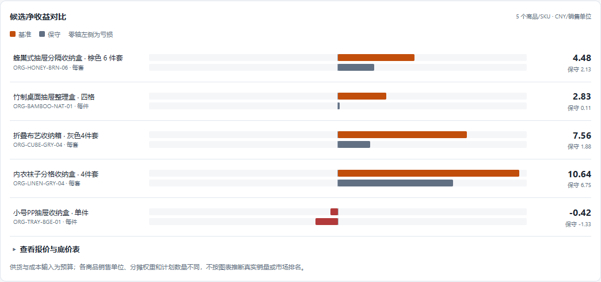
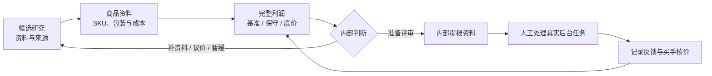
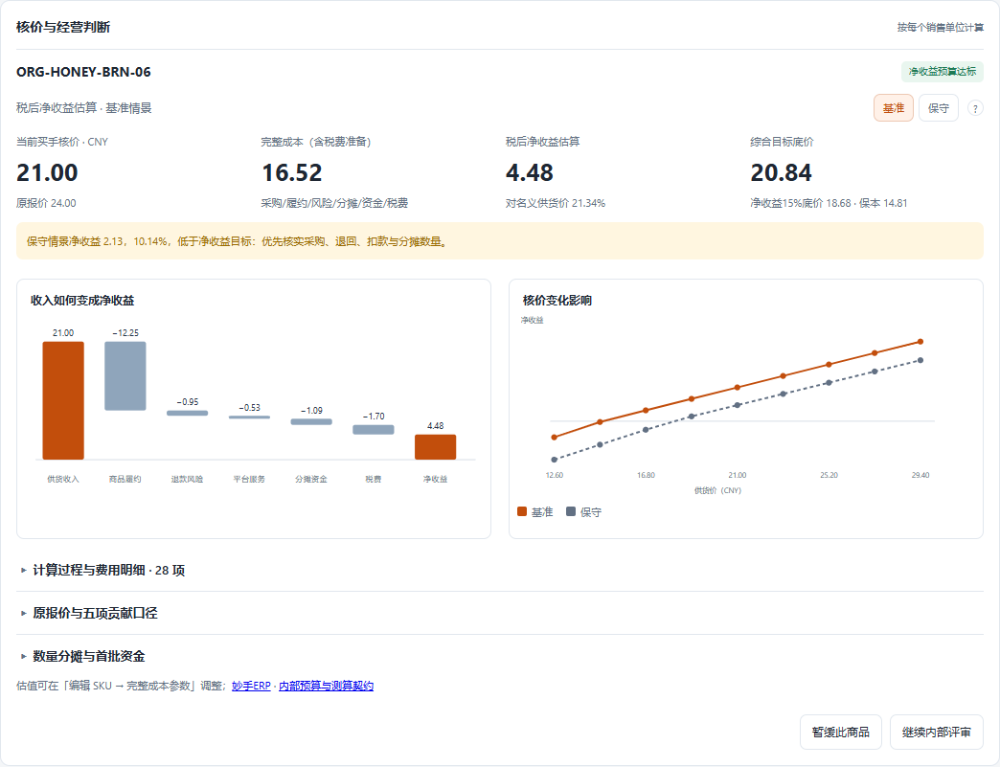
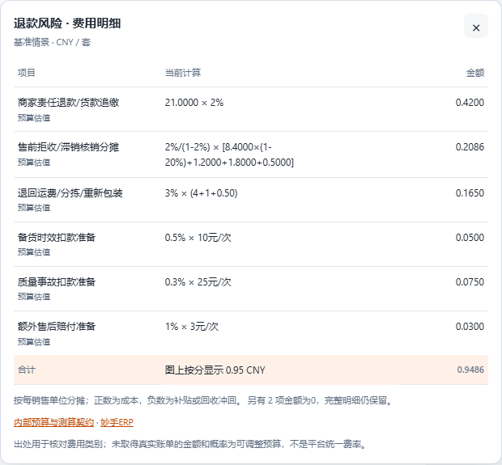

# TEMU-ERP · 全托管选品与买手提报工作台

**把“这个商品为什么值得供货”变成一条有依据、能算账、能复用资料的工作流。**

面向跨境电商全托管供货场景的可运行MVP。围绕德国市场普通非电收纳用品，把候选研究、SKU资料、完整成本、买手核价记录和内部评审资料放在同一条链路里。

这是从开发能力切入业务实操的面试作品。目前是单人本地工作台，并非完整生产ERP；没有接入真实Temu店铺或自动上架。



## 解决什么问题

- **选品结论难复核**：商品尺寸、件数、价格背景与来源关联，区分“规格可比”“规格不同”“资料不足”。
- **只算采购差价容易高估利润**：拆开退款、退回、扣款、人工、平台服务、分摊、资金和税费，合计到每个销售单位。
- **买手核价后要重复改表**：核价关联对应SKU，保留原报价和反馈历史，重新计算收益与底价。
- **研究资料重复录入**：同一份商品资料可生成内部评审HTML、结构化JSON及只读填写计划。

## 工作流



真实后台任务由人工处理，项目没有执行该步骤。全托管商品能否上架、核价及任务要求以实际平台和买手流程为准。

## 界面与交互

主导航只有 **候选研究 / 商品提报 / 反馈跟进**。低频设置、来源和接口状态收在抽屉中；新建候选直接进入信息填写。



鼠标移到瀑布图的项目、金额或柱子，可查看费用组成、当前公式、四位小数金额及来源；支持键盘和手机点击。明细直接取后端计算结果，切换基准／保守后同步变化。



## 一个能算清楚的案例

六件套收纳盒当前案例核价为 **21元／套**：

| 指标 | 结果 |
|---|---:|
| 原五项可变成本 | 12.50元 |
| 原五项贡献 | 8.50元，不能当最终净利润 |
| 补全后的成本，含税费准备 | 16.5184元 |
| 基准税后净收益预算 | **4.4816元／套** |
| 保守情景净收益预算 | **2.1295元／套** |
| 综合目标底价 | 20.84元／套 |

共有5个离线商品案例，含完整成本后亏损的PP小盒。公开规格有原文；采购、公司费用、门槛、扣款概率和买手反馈属于明确标记的预算／构造案例，不是实际店铺业绩或Temu官方费率。德国零售价格不直接当人民币供货收入。

计算细节、两种利润率的区别及来源见 **[利润模型](docs/PROFIT_MODEL.md)**。

## 快速运行

需要 **Python 3.11+**，不需要安装第三方运行依赖，也不需要Node或模型API Key。

```bash
git clone https://github.com/666whatcanisay/TEMU-ERP.git
cd TEMU-ERP
python scripts/seed-demo.py
python -m app.backend.api.server
```

打开 **http://127.0.0.1:8765**。默认只监听本机；Ctrl+C停止。数据库自动保存在当前项目的 `data/workbench.db`。离线案例导入不访问网络，重复运行保留已有记录和修改。

Windows也可运行 `powershell -ExecutionPolicy Bypass -File scripts/start-workbench.ps1`。如果不加载五商品案例，直接启动会建立最小初始样例。详见[运行与操作说明](RUNBOOK.md)。

## 设计思路

- **先闭环一条业务路径**：在真实公司模板和数据未知时，先验证资料、计算与反馈能否复用。
- **高内聚、低耦合**：领域计算、应用用例、存储／采集适配器与UI分层；费用浮层只负责交互。
- **渐进展示**：首屏只给关键结果与风险，明细、假设、公式和来源按需展开。
- **证据优先**：费用类别有来源不等于默认数值有依据；规则提取候选不自动成为已确认字段。
- **维护明确口径**：Decimal、销售单位、币种检查、变更确认失效、原始核价留痕、防重复计费。

技术栈：Python标准库HTTP服务、SQLite、原生HTML/CSS/JavaScript。采用分层单体，未引入微服务或复杂构建工具。

## 已验证与未接入

| 状态 | 内容 |
|---|---|
| 已实现并验证 | 本地保存、商品及多SKU、反馈核价、完整利润、三类图表、费用浮层、导入导出、备份恢复 |
| 已有公开页面案例 | HTTP读取、快照及规则提取；不保证任意网站可采集 |
| 预留，未接入 | DSH、DeepSeek、公司真实类目模板、Temu只读账号、影刀／RPA执行 |
| 需要真实业务验证 | 采购及账单、合规材料、税务口径、团队工时／遗漏率改善、平台通过率 |

应用测试 **75项**、starter领域测试 **24项**。已做桌面和手机尺寸浏览器验证，以及独立HTML评审单的明细交互验证。CI会在Windows和Ubuntu执行代码测试；状态以仓库实际运行结果为准。

```bash
python -m unittest discover -s app/tests -v
# 在 starter/ 目录下执行：
python -m unittest discover -s tests -v
# 回到仓库根目录：
python scripts/validate_bundle.py
```

## 面试阅读路线

1. [三分钟面试演示](docs/INTERVIEW.md) — 展示什么、怎么讲、哪些效果尚未证明。
2. [工作流与业务边界](docs/WORKFLOW.md) — 从候选到反馈，什么时候补证据或暂缓。
3. [架构与设计取舍](docs/ARCHITECTURE.md) — 模块职责和后续扩展方式。
4. [利润计算与来源](docs/PROFIT_MODEL.md) — 成本、门槛、风险假设与防重复。
5. [来源登记](research/sources.json) / [字段映射候选](contracts/temu_field_map.json) — 可追溯依据，不等于真实后台模板。

仓库不包含工作中的数据库、登录凭据、浏览器会话、下载的第三方源码和安装程序。[第三方参考说明](docs/THIRD_PARTY.md)列出了资料用途。临时公网地址依赖本机和穿透服务，不作为仓库的长期演示入口。
