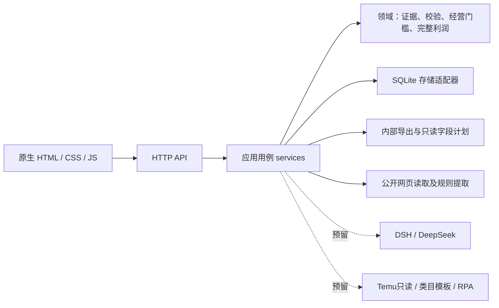

# 架构与设计取舍

## 为什么做这个形态

短周期内先跑通“研究、成本判断、整理资料、记录反馈”的一条业务路径。用可审阅的数据和程序输出解释决定，比先搭完整ERP更容易验证价值。界面只保留三个主工作区，说明、来源和低频参数通过折叠或浮层按需展开。

## 模块边界

| 目录或模块 | 职责 | 避免什么耦合 |
|---|---|---|
| `app/backend/domain/` | 数据校验、证据比较、Decimal金额计算 | 不依赖浏览器、数据库或平台账号 |
| `app/backend/application/` | 协调用例、核价生效范围、准备状态、导出资料 | 不把HTTP解析写进业务计算 |
| `app/backend/adapters/` | SQLite、公开读取、规则提取、导入导出及模型端口 | 外部工具可替换，不侵入金额规则 |
| `app/backend/api/` | 请求解析、路由、错误响应及静态资源 | 保持接口层薄 |
| `profit-view.js` | 将后端明细渲染为图表、表格及模板 | 不在浏览器另建一套利润算法 |
| `profit-popover.js` | 悬停、点击、键盘、定位及关闭行为 | 交互不参与费用计算 |
| `contracts/`、`research/` | 数据契约、来源登记及字段映射候选 | 来源和平台假设可以单独审阅 |

这是分层单体，使用显式数据结构和可替换适配器；不是微服务或插件市场。后续优化一个费用浮层、替换采集器或调整经营规则，主要改对应模块。

## 几个重要决定

**金额使用Decimal。** 后端维护四位小数费用明细，汇总与明细保持一致，界面主结果显示到分。旧五项贡献与完整利润是不同口径，分别命名，防止复用一个“利润”字段导致误解。

**采用SQLite。** 适合当前单人本机演示；候选、来源、政策、反馈和修订历史持久化。没有为了技术展示切换到MySQL。多人并发、访问权限和共享数据库应在真实使用场景明确后再设计。

**证据和假设分开。** 公开参照商品的尺寸、套装和观察日期有出处；采购价、扣款概率、分摊数量是预算。数值来源与费用类别来源分别登记，避免“引用了ERP说明”被误解成“引用了官方费率”。

**简洁采用渐进展开。** 首屏给出价格、完整成本、净收益、底价和重要风险；费用浮层展开到项目、公式、四位小数金额及来源。支持悬停、键盘和手机点击，交互不只依赖鼠标。

**平台能力按真实状态显示。** 公开网页读取和规则提取已有成功案例；DSH、DeepSeek、真实模板、平台只读和RPA仍为预留。内部评审单不伪装成Temu导入模板。

## 当前技术边界

- Python标准库HTTP服务，无前端构建步骤，便于面试现场启动；不属于生产级公网部署方案。
- 默认只监听回环地址，没有账号、角色权限、多人协同和审计防篡改能力。
- 临时内网穿透依赖本机在线和第三方连接，仓库不提供长期在线承诺。
- 已验证可计算、可保存、可追溯、可导出；尚无真实团队的效率提升或上架通过率对照数据。
