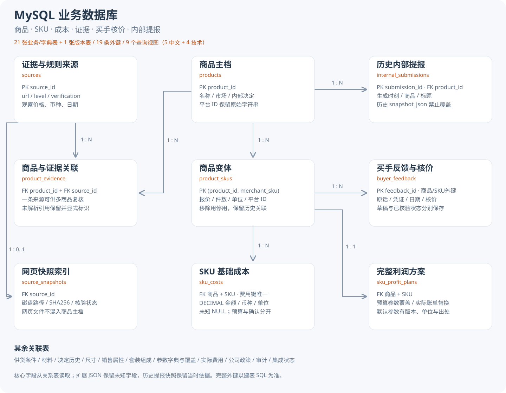

# 数据库设计与面试说明

MySQL 业务库：`temu_workbench`，`127.0.0.1:3306`。当前版本 `20261126-relational-v2`。在 Navicat 右键数据库刷新即可看到新表；原五表以 `legacy_v1_` 前缀归档，应用已切换到关系表。



[浏览器讲解页](DATABASE_TOUR.html) · [完整建表 SQL](../database/migrations/002_relational_entities.sql) · [面试演示 SQL](../database/interview-queries.sql) · [迁移与备份](MYSQL.md)

## 一分钟讲法

> 第一版把多种业务放在通用记录表里，用 JSON 快速验证选品、成本和买手反馈流程。业务稳定后，我按真实关系拆出商品、SKU、成本、证据、反馈和提报。
>
> 商品和 SKU 是一对多；商品与来源通过关联表形成多对多；成本和利润参数按 SKU 保存；核价关联对应 SKU。网址、金额、日期这些常查询字段都有独立列，并用外键、唯一键和事务保证一致性。
>
> 金额使用 MySQL DECIMAL，后端使用 Python Decimal。未知金额保留 NULL，平台 ID 保留字符串。未建模的字段才留扩展 JSON，历史提报保留独立快照，避免后来改价把旧评审记录改掉。
>
> 迁移前备份，用事务迁入新表并重建旧 DTO 对账；切换后逐个比较商品的利润结果。旧表保留归档。关系型设计服务于查询、对账和维护，不只增加表数量。

## 实际表与职责

当前是 **21 张业务/字典表 + 1 张迁移记录表、19 条外键、4 个查询视图**。SQLite 保留原结构用于兼容迁移及基础测试，不是 MySQL 的同步副本。

| 模块 | 表 | 关键设计 |
|---|---|---|
| 商品 | `products` | 名称、市场、材质、内部决定直接为列，平台 ID 为字符串 |
| 供货与材料 | `product_suppliers`、`product_materials`、`product_decisions` | 商品供货条件、材料状态、内部决定历史分开 |
| SKU | `product_skus` | `(product_id, merchant_sku)` 复合主键，同款不同变体独立 |
| 规格 | `sku_measurements`、`sku_attributes`、`sku_components` | 销售单位/单件/包装分层，属性和套装组成按行保存 |
| 基础成本 | `sku_costs` | 每个 SKU/费用键唯一，金额、币种、单位、确认和凭证独立列 |
| 完整模型 | `sku_profit_plans`、`sku_profit_parameters`、`sku_actual_costs` | 方案、预算覆盖、实际账单替换分开 |
| 参数字典 | `profit_parameter_definitions` | 40 项参数有模型版本、默认值、单位与依据；启动检查默认值和代码模型一致 |
| 来源 | `sources`、`product_evidence` | 网址集中、多对多关联；无法解析的引用外键留 NULL 并可查询 |
| 网页文件 | `source_snapshots` | 原文件路径、SHA256、核验状态；文件本体留磁盘 |
| 买手反馈 | `buyer_feedback` | 商品外键、可解析 SKU 外键、日期、核价、原话与凭证 |
| 公司政策 | `business_policies` | 贡献率/加价率、门槛、确认人、来源和版本 |
| 审计与提报 | `field_revisions`、`internal_submissions` | 字段 before/after 独立可查，历史评审按 ID 禁止覆盖 |
| 运维 | `integration_status`、`schema_migrations` | 接口状态和数据库迁移版本分开 |

没有取得供应商主体身份时，只保存某商品的供货条件，不虚构统一供应商 ID。当前没有订单、真实结算流水、库存和店铺权限业务，因此不建立空的对应模块。

## 在 Navicat 怎么展示

1. 打开 `products`：商品名称、市场和决定不再藏在 JSON。
2. 打开 `product_skus` 和 `sku_costs`：展示商品一对多 SKU、SKU 一对多费用。
3. 打开 `sources`：直接看到 `url`、出处级别和观察日期。
4. 打开视图 `v_product_evidence`：把商品、来源网址和网页哈希一次关联出来。
5. 打开 `v_buyer_quote_history`：展示原始反馈、SKU 和核价历史。
6. 打开 `schema_migrations` 与旧表归档：解释如何保留数据完成升级。

```sql
SELECT product_id, product_title, source_title, url,
       verification, snapshot_file, hash_verified
FROM v_product_evidence
WHERE product_id = 'DE-DRAWER-006';
```

其余可直接执行的查询见 [interview-queries.sql](../database/interview-queries.sql)。查询都是只读 SELECT，不改工作数据。

## 为什么保留部分 JSON

`extension_json` 存放未建模字段，以及缺失/null、数值格式、键顺序等兼容元数据；核心字段已从它移出。应用从关系列和子表重建 DTO，直接查询关系表就能查出商品、金额和网址。JSON 扩展不是另一份完整商品主档。

`internal_submissions.snapshot_json` 是生成当时的完整评审快照，应保留当时的算法结果与依据。`field_revisions` 的 before/after 可以是对象，适合 JSON。来源原始登记、提取候选及未核验平台字段也保留原文，不猜固定枚举。

## 事务、约束与索引

- 商品、SKU、规格、成本和字段修订同事务保存；任何子表写入失败一起回滚。
- 跨多表读取在一致的事务视图内完成；当前 HTTP 服务仍为单人串行应用。
- 外键阻止无商品的 SKU、费用、反馈和提报；移除 SKU 使用停用标志，保留历史核价引用。
- 金额为 `DECIMAL(30,12)`，超出范围或精度直接拒绝，不静默舍入。界面按分显示，模型明细四位小数。
- `NULL` 表示未知，零表示已知为零。五项成本视图遇到缺失金额/币种或单位不一致时不输出可误解的合计。
- 平台 ID/商家编码为大小写敏感字符串，避免大整数精度与大小写混淆。
- UTC `DATETIME(6)` 用于排序与查询；原有时区文本保留于兼容元数据。仅有日期的旧网页记录明确标注日期精度。
- 工作列表按市场/决定/时间建索引；反馈和审计按商品/状态/时间建索引，来源关联建立反向索引。没有用小样本宣称性能提升百分比。

默认参数字典由版本化模型发布，不直接在 SQL 中改它来调业务。调整单个 SKU 使用参数覆盖；启动发现字典与代码模型不一致会拒绝静默计算。

## 本机迁移验收（2026-11-26）

| 项目 | 结果 |
|---|---|
| 原始业务记录 | 12 商品、4 反馈、1 政策、6 商品来源全部保留 |
| 迁移前后旧 DTO 全量摘要 | 完全一致 |
| 业务输出 | 全部 12 个候选的贡献、核价测算及完整利润结果一致 |
| 新结构 | 12 SKU、60 基础成本行、31 条统一来源 |
| 网页证据 | 5 份已有文件入快照索引，5 份哈希一致 |
| 审计/提报 | 8 条修订、8 份历史提报保留 |
| 迁移保护 | 原五表改名归档，迁移前旧格式与迁移后全量实体备份均保留 |

31 条来源包含商品观察与参考登记，登记不等于正文已核验。未证明的采购、概率和核价仍是案例输入。此验收不表示已通过真实店铺业务验收。

## 能讲清楚的限制

没有多用户账号、版本冲突保护和不可篡改审计；直接 SQL 改动会绕过应用校验与修订记录。网页快照索引目前保存每来源的最新一份，不是完整多版本档案。数据库备份不包含磁盘网页文件、MySQL 账号或服务配置。真实订单、结算与库存需在取得业务数据后另行建模。

## 一手设计依据

- [MySQL 外键](https://dev.mysql.com/doc/refman/8.0/en/create-table-foreign-keys.html)：父子关联和删除约束。
- [MySQL DECIMAL](https://dev.mysql.com/doc/refman/8.0/en/precision-math-decimal-characteristics.html)：定点数的精度与范围。
- [MySQL 隐式提交](https://dev.mysql.com/doc/refman/8.0/en/implicit-commit.html)：DDL 与数据迁移事务分阶段，不能假装全程可回滚。
- [InnoDB 一致性读](https://dev.mysql.com/doc/refman/8.0/en/innodb-consistent-read.html)：读取一致快照。
