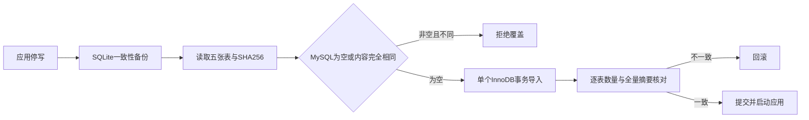

# MySQL配置、迁移与恢复

## 设计

默认引擎为MySQL 8，表使用InnoDB、utf8mb4和大小写敏感的utf8mb4_bin排序。ID仍是字符串，原JSON结构和Decimal利润计算不变。应用账号仅获得项目库内的读写和建表权限，不用于管理其他数据库。

`storage_relational.py`维护共享的记录校验与序列化；MySQL与SQLite适配器分别处理SQL方言、连接和备份。数据库连接失败明确报错，不自动回退到另一份SQLite数据。

## 使用已有MySQL

```bash
python -m pip install -r requirements.txt
python scripts/configure-mysql.py --host 127.0.0.1 --port 3306
python scripts/seed-demo.py
python -m app.backend.api.server
```

配置脚本通过隐藏输入获取root密码，不把它保存到项目。它创建`temu_workbench`库和受限应用账号；若同名账号已存在，不重置他人的密码，改用新账号。随机应用密码只保存在被Git忽略的`data/mysql.local.json`。已有有效配置不会被覆盖。

也可不运行配置脚本，使用已经授权的应用账号设置`WORKBENCH_MYSQL_HOST/PORT/USER/PASSWORD/DATABASE`。数据库需事先创建，账号需在该库内拥有SELECT、INSERT、UPDATE、DELETE、CREATE、INDEX、ALTER权限。进程环境变量优先于本机文件；示例文件不含真实密码，应用不会自动加载.env。

## 没有正在运行的MySQL

- Docker：在本机环境分别设置`WORKBENCH_MYSQL_PASSWORD`和`MYSQL_ROOT_PASSWORD`，运行`docker compose -f compose.mysql.yml up -d`。容器仅将3306映射到127.0.0.1，数据使用Docker卷；应用继续用同一应用密码连接。不要将实际.env或数据卷提交Git。
- Windows已安装mysqld但无服务启动权限：可执行`python scripts/start-mysql-local.py --initialize`，建立项目专用的3307实例，密码通过隐藏输入或一次性环境变量取得。初始化只允许空的`data/mysql-server`，绝不初始化或删除系统原数据目录。后续启动不加`--initialize`。该实例需另行运行`configure-mysql.py --port 3307`；不要与已有3306实例混淆。

当前开发机已使用用户启动的MySQL80服务，实际连接3306。专用3307方案只是可选的运行工具，并非当前业务库。

## 旧SQLite迁移

1. 关闭工作台，防止迁移期间继续写入。脚本还会检查应用端口已关闭。
2. 使用配置脚本或环境变量连到空的MySQL项目库。
3. 执行：

```bash
python scripts/migrate-sqlite-to-mysql.py --app-stopped
```

默认源文件为`data/workbench.db`，也可使用`--source`指定。流程如下：



迁移保留`records`、`revisions`、`adapter_status`、`submissions`和`snapshots`的原ID、时间、索引字段及JSON内容；不是仅导出候选表。相同数据可重复核验，非空且不同的目标库拒绝覆盖。旧SQLite文件和`data/backups/before-mysql-*.db`保留。

当前本机首次迁移：23条业务记录、8条修订、8条接口状态、8条内部提报，快照表0条。全部五表的迁移前后SHA256一致。应用启动会重新登记接口运行状态及时间，属于正常状态刷新，不是业务资料丢失。

## 备份与恢复

设置与集成中的备份生成`*.mysql.json`，含固定版本、五表完整原始行和SHA256。导出使用一致性读；恢复先检查格式、主键、JSON及摘要，再在一个InnoDB事务中替换数据。中途失败会回滚，不留下半份数据库。恢复只接受当前引擎的备份格式，路径必须是备份目录中的文件名。

这是完整**工作台业务数据**备份，不包含MySQL账号、服务配置、其他数据库或磁盘上的原始HTML快照文件。需要完整灾备时还应备份MySQL数据或使用原生备份工具，以及另行保留`.cache`中需要的原文件。

## 回退

停止应用，设置`WORKBENCH_DB_DRIVER=sqlite`后可重新查看迁移前保留的SQLite。它不包含迁移后新增的MySQL记录；这不是双写方案。切回前应先备份MySQL，并明确哪一份数据作为后续工作来源。

## 测试与依据

基础测试不依赖MySQL。真实集成测试必须明确启用，并指定以`_test`或`_ci`结尾、且不同于应用库的测试schema；测试会重置该测试schema的五表，绝不能指向业务库。

```powershell
python scripts/configure-mysql.py --with-test-database
$env:WORKBENCH_TEST_MYSQL='1'
$env:WORKBENCH_TEST_MYSQL_DATABASE='temu_workbench_test'
python -m unittest discover -s app/tests -v
```

若已有配置，应由管理员提前创建并授权独立测试库；配置脚本不会为了测试重置现有凭据。GitHub Actions另设MySQL8容器执行12项真实集成测试，覆盖中文、ID、全表迁移、损坏备份保护、恢复及商品/历史保存回滚、闲置连接重开及完整利润工作流。

- [PyMySQL连接参数](https://pymysql.readthedocs.io/en/latest/modules/connections.html)：UTF8、autocommit及连接行为。
- [MySQL事务与一致性](https://dev.mysql.com/doc/refman/8.0/en/innodb-consistent-read.html)：InnoDB一致性读。
- [MySQL Windows启动说明](https://dev.mysql.com/doc/refman/8.0/en/windows-start-command-line.html)：服务和命令行实例。

不在写入失败后自动重放SQL，避免连接异常时产生“到底提交过没有”的重复写入。每次新操作前检测连接；显式事务期间不偷偷重连。
