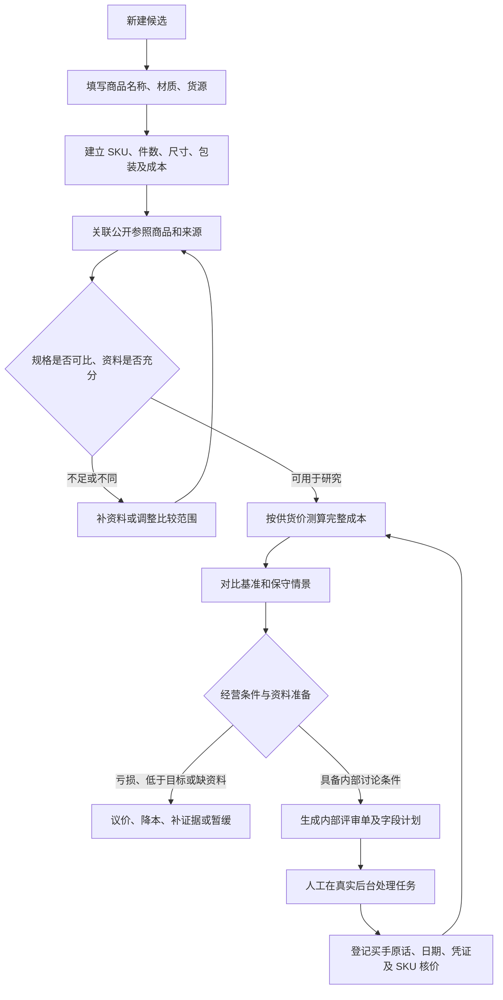

# 从候选研究到内部评审

这个项目围绕一个实际问题：全托管供货商在买手核价后，如何把商品依据、供货资料、成本和反馈整理成一次可复核的内部决定。研究范围为德国市场普通非电收纳用品；最终经营模式、类目和后台任务需由公司核对。

图中“人工在真实后台处理任务”是工作边界说明，项目没有连接或执行这一步。导出评审单也不等于平台已接收。

## 三个工作区怎么分工

| 工作区 | 操作 | 留下的结果 |
|---|---|---|
| 候选研究 | 看五商品对比、新建候选、录入来源、比较件数和尺寸 | 有来源的候选记录与内部决定 |
| 商品提报 | 填商品资料、独立编辑 SKU、测成本、查看费用浮层、生成资料 | 内部评审 HTML、JSON、只读填写计划 |
| 反馈跟进 | 记录任务阶段、反馈原话、日期、凭证和对应 SKU 的供货价 | 可回看、可重新计算的核价历史 |

来源、经营门槛、导入导出、备份和接口状态收在次级抽屉。新建候选会直接展开名称录入，保存后进入 SKU；“查看详情”会定位到该商品，不让用户自己在长列表下面找。

## 六件套案例怎么走

1. 公开参照商品提供六件套、单件尺寸、材质和德国零售价格背景；公开页面未提供的销量保持未知。
2. 填写人民币采购、包材和国内运费预算。人民币供货价和欧元消费者零售价分开。
3. 原拟报价24元；案例反馈依次为20元、12元、21元，用来展示核价变化如何影响判断。这些反馈不是实际买手承诺。
4. 当前21元对应税后净收益预算4.4816元，保守2.1295元。旧五项贡献8.50元折叠展示，不能当完整利润。
5. 可生成内部评审资料，但类目模板、供应商与合规材料仍可能待核对。系统保留这些待办，不将财务达标解释为允许上架。

## 会阻止哪些错误判断

- 未知价格、币种或成本不能默认为0；币种及销售单位不一致时停止给出确定结论。
- 一个SKU的买手核价不会自动覆盖同商品的所有变体。
- 来源有链接不等于同规格；“规格不同”和“资料不足”分开提示。
- 改金额或来源后，旧的确认状态失效。
- 没有平台返回值时，不编造商品ID、SKU ID、SKC ID或属性枚举。
- 亏损和低于门槛直接显示；缺少真实类目模板仍作为待办保留。

反馈阶段支持分支、退回和重复核价，不假设所有商品都严格走相同的线性流程。
